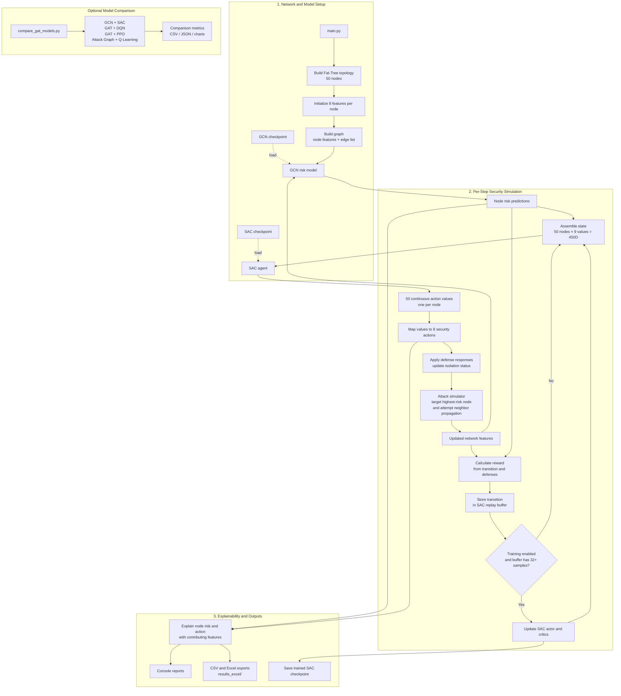

# Network Security Project Architecture

## Architecture Flow

## Eight Security Actions

The SAC agent produces a continuous value for each node. The action mapper converts each value into one of the following discrete security responses:

| ID | Security action | Purpose |
|---:|---|---|
| 0 | **Allow Traffic** | Permit normal traffic; lowest intervention. |
| 1 | **Monitor** | Continue observing suspicious or uncertain activity. |
| 2 | **Raise Alert** | Flag suspicious activity for security review. |
| 3 | **Rate Limit Traffic** | Reduce traffic to limit possible flooding. |
| 4 | **Block Source IP** | Prevent traffic from a suspected malicious source. |
| 5 | **Block Destination Port** | Restrict access to a targeted service port. |
| 6 | **Isolate Host** | Isolate a compromised host to help contain spread. |
| 7 | **Terminate Session** | End a suspicious active connection. |

In the simulation, the selected actions affect node isolation and the probability of attack propagation to neighboring nodes.

## Slide Summary

**Network state → GCN risk prediction → SAC defense selection → attack simulation → reward and learning → explainable reports**

The comparison runner is a separate evaluation path that compares the listed policies using shared network simulation and reward logic.

> **Implementation note:** The current `main.py` simulation initializes predefined 8-feature values. Although `combine.csv` and data-processing utilities are present, `main.py` does not currently load that CSV in its main simulation flow.