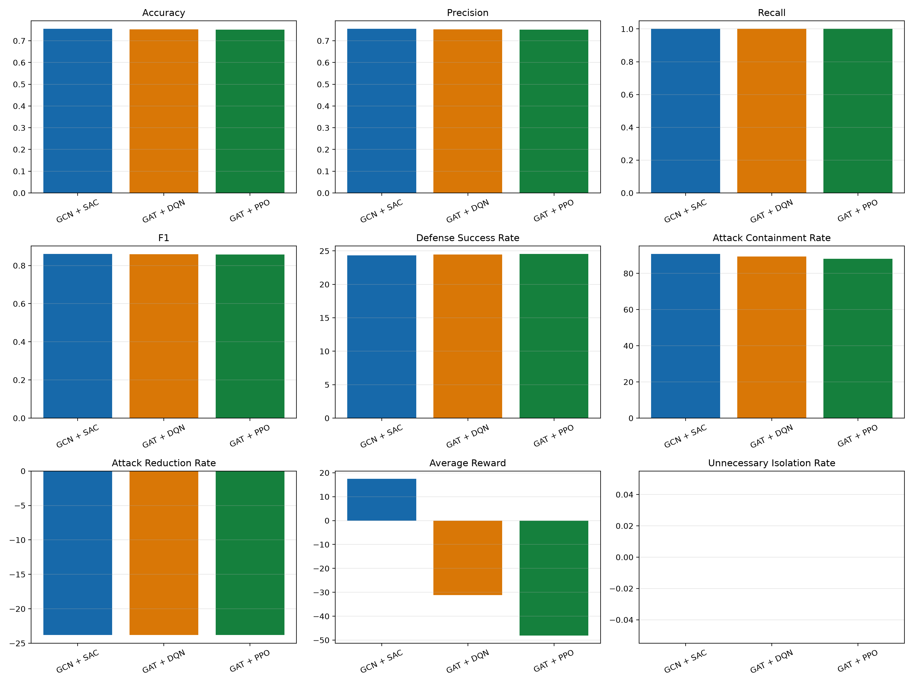
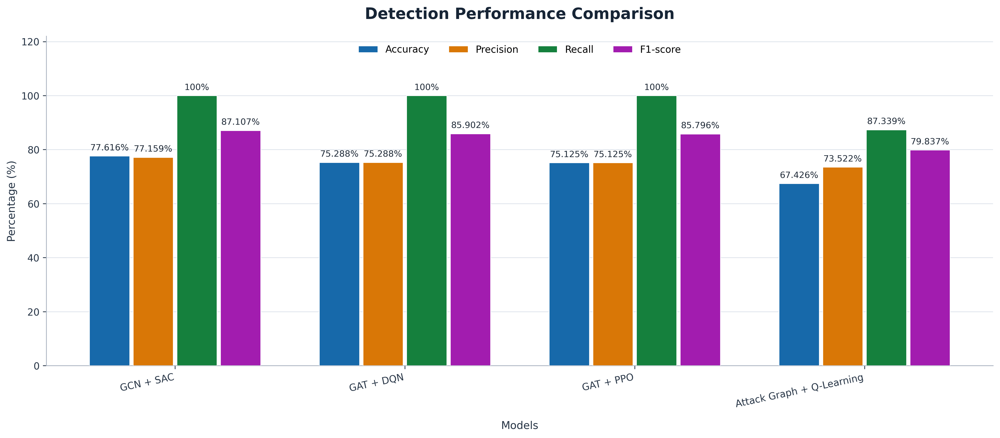
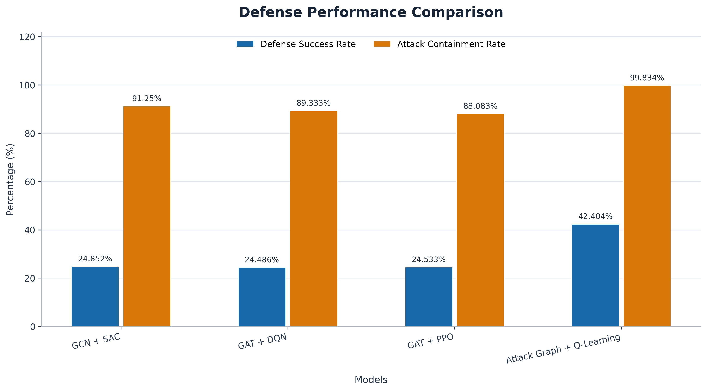
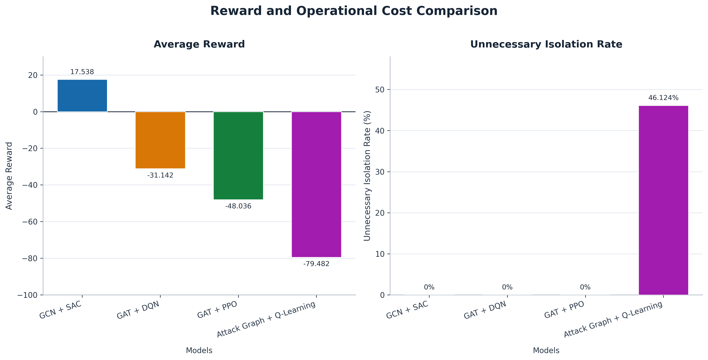

# AI Network Attack Detection and Defense


## Project Overview

AI Network Attack Detection and Defense is a Python research simulator for studying graph-based network attack detection and automated defense policies. It combines a 50-node Fat Tree-style network topology, eight node security features, a Graph Convolutional Network (GCN), and reinforcement-learning agents.

The project:

- Simulates compromise and attack propagation across a network graph.
- Predicts node risk with a GCN.
- Uses Soft Actor-Critic (SAC) and optional GAT/DQN, GAT/PPO, and attack-graph Q-learning policies to select security actions.
- Explains node-level decisions using a rule-based Explainable AI (XAI) module.
- Exports per-step decisions and produces CSV, JSON, and visualization artifacts.
- Evaluates binary network-flow detection and synthetic defense behavior against `combine.csv`.

This repository is an offline research and evaluation project. It does not connect to live packet capture, network devices, firewalls, or cloud services, and its simulated containment metrics are not real-world protection guarantees.

## Key Features

- 50-node Fat Tree-style data-center topology with core, aggregation, edge, and host nodes.
- Eight-dimensional node feature representation.
- GCN-based node-risk prediction.
- SAC continuous action policy with 50 node actions mapped to eight security responses.
- GAT-DQN, GAT-PPO, and tabular attack-graph Q-learning comparison implementations.
- Synthetic generic, DDoS, PortScan, and Bot attack scenarios.
- Action-dependent compromise and attack-spread probabilities.
- Reward calculation based on containment, node risk, compromised nodes, and defense cost.
- Per-node XAI explanations, confidence scores, severity values, and top contributing features.
- CSV and optional Excel exports of simulation decisions.
- Reproducible CSV dataset scanning and grouped train/validation/test evaluation.
- Saved model checkpoints, comparison metrics, plots, PDFs, and timestamped experiment results.
- Unit tests for topology, attack scenarios, and policy-alert accuracy.

## Technology Stack

| Area | Technology |
|---|---|
| Language | Python |
| Deep learning | PyTorch |
| Graph neural networks | PyTorch Geometric with GCNConv and GATConv |
| Numerical computing | NumPy |
| Tabular data | pandas |
| Machine-learning evaluation | scikit-learn |
| Visualization | Matplotlib, Seaborn |
| Optional Excel output | openpyxl |
| Data/artifact formats | CSV, JSON, NPZ, PKL, PT, PNG, PDF, XLSX |

The repository does not contain a root `requirements.txt`, `pyproject.toml`, or lock file. Install dependencies explicitly in the setup section.

## System Architecture

```text
combine.csv
    |
    +--> GCN training/evaluation and synthetic graph workflows
    |
    +--> Dataset profiling, train/validation/test splits, detection metrics

main.py simulation
    |
    +--> Fat Tree graph + 50 x 8 node features
    +--> GCN risk prediction
    +--> 450-value network state
    +--> SAC actor
    +--> 50 continuous values mapped to eight security actions
    +--> Synthetic attack propagation
    +--> Transition reward
    +--> Replay buffer and SAC updates
    +--> XAI explanations
    +--> CSV/Excel exports

comparison/evaluation scripts
    |
    +--> GCN + SAC
    +--> GAT + DQN
    +--> GAT + PPO
    +--> Attack Graph + Q-learning
    +--> Metrics, charts, JSON, CSV, and reports
```

### Node State

Each node has eight values:

| Index | Feature | Description |
|---:|---|---|
| 0 | Compromised | Binary compromise indicator |
| 1 | Risk Score | Risk-like score used by the attack simulator |
| 2 | Isolation Status | Whether the node is isolated |
| 3 | Vulnerability Score | Synthetic vulnerability indicator |
| 4 | Flow Duration | Normalized flow-duration indicator |
| 5 | Flow Packets/s | Normalized packet-rate indicator |
| 6 | Flow Bytes/s | Normalized byte-rate indicator |
| 7 | Node Degree | Normalized graph degree |

The main GCN/SAC state concatenates each node's eight features and GCN risk prediction, producing `50 x 9 = 450` state values.

### Security Actions

| ID | Action | Main simulation effect |
|---:|---|---|
| 0 | Allow Traffic | No isolation |
| 1 | Monitor | No isolation |
| 2 | Raise Alert | No isolation |
| 3 | Rate Limit Traffic | No isolation |
| 4 | Block Source IP | No isolation |
| 5 | Block Destination Port | No isolation |
| 6 | Isolate Host | Sets isolation status to 1 |
| 7 | Terminate Session | Sets isolation status to 1 |

In the generic attack scenario, the attacker targets the node with the highest risk score and attempts to spread to neighbors. Neighbor actions reduce or eliminate the spread probability.

## Project Folder Structure

```text
AIOT-Project/
├── main.py                           # Main 50-node GCN/SAC simulation
├── combine.csv                       # 79-column network-flow dataset
├── train_gcn.py                      # GCN training using synthetic graphs
├── run_model_evaluation.py           # Detection and defense-policy evaluation
├── compare_gat_models.py             # GAT/DQN, GAT/PPO, SAC, and Q-learning comparison
├── evaluate_accuracy.py              # Defense and detector accuracy experiments
├── diagnose_gcn.py                   # GCN checkpoint/data diagnostics
├── check_sac_checkpoint.py           # SAC checkpoint inspection
├── generate_results_plots.py         # Generates result plot figures
├── generate_comparison_charts.py     # Generates comparison charts
├── reward_functions.py               # Transition reward implementation
├── reward_options.py                 # Alternative reward definitions
├── reward_mechanism_explained.py     # Reward-formula reference
├── algorithms.md                     # Algorithm notes
├── attacker/
│   └── attacker.py                   # Generic, DDoS, PortScan, and Bot scenarios
├── data/
│   └── data_processor.py             # CSV loading and synthetic graph preparation
├── graph/
│   ├── build_graph.py                # PyTorch/edge-index graph conversion
│   └── fat_tree_topology.py          # 50-node topology and node degrees
├── models/
│   ├── gcn_model.py                  # GCN risk model
│   ├── gat_models.py                 # GAT networks
│   ├── sac_model.py                  # SAC actor and critic networks
│   ├── gcn_pretrained.pt             # Saved GCN checkpoint
│   └── sac_agent.pt                  # Saved SAC checkpoint
├── decision/
│   ├── sac_agent.py                  # SAC replay, update, load, and save
│   ├── gat_agents.py                 # GAT-DQN and GAT-PPO agents
│   ├── action_decider.py             # Eight-action mapping and rules
│   ├── attack_graph_q_learning.py    # Attack graph and tabular Q-learning
│   └── policy.py                     # Policy helpers
├── explainability/
│   ├── xai_engine.py                 # Per-node and network explanations
│   ├── xai_integration.py            # XAI integration wrappers
│   ├── xai_demo.py                   # XAI demonstration
│   └── *.md                          # XAI implementation documentation
├── utils/
│   ├── excel_exporter.py             # CSV and optional XLSX export
│   ├── replay_buffer.py              # SAC replay buffer
│   └── logger.py                     # Console logging helper
├── test_*.py                         # Unit and smoke tests
├── evaluation_results/               # Timestamped evaluation artifacts
├── comparison_results/               # Model comparison CSV/JSON/plots
├── comparison_charts/                # Generated comparison charts
├── results_plots/                    # Generated analysis plots
├── report_comparison_20261029/       # Evaluation report and figures
└── results_excel/                    # Timestamped per-step CSV/XLSX exports
```

Additional root-level Markdown files document architecture, implementation phases, attack scenarios, chapters, and project workings.

## Prerequisites

- Python 3.x
- `pip`
- CPU execution or a PyTorch-compatible CUDA environment
- Enough disk space for `combine.csv`, model checkpoints, plots, and timestamped exports
- Optional: `openpyxl` for `.xlsx` exports

The repository was verified in an environment running Python 3.14.0. No supported Python version range is declared in the repository.

## Installation and Setup

Run commands from the project root.

### 1. Create a Virtual Environment

```powershell
python -m venv .venv
.venv\Scripts\Activate.ps1
python -m pip install --upgrade pip
```

### 2. Install Required Packages

```powershell
python -m pip install torch numpy pandas scikit-learn matplotlib seaborn torch_geometric openpyxl
```

`openpyxl` is optional. CSV export remains available when it is not installed.

For CUDA builds, install a PyTorch/PyTorch Geometric combination compatible with the installed GPU and driver. The repository does not pin dependency versions.

### 3. Confirm Project Data

`combine.csv` must remain in the project root for the CSV workflows. The current dataset has 79 columns and 2,214,469 rows. The GCN and evaluation scripts require a `Label` column.

## Environment Variables

The project does not currently read environment variables or require a `.env` file. There are no configured API keys, database credentials, or external-service secrets in the source code.

The only runtime controls are command-line arguments.

## How to Run the Project

### Main GCN/SAC Simulation

Run the default configuration: five episodes, 20 steps per episode, and SAC training enabled.

```powershell
python main.py
```

Custom episode and step counts:

```powershell
python main.py --num_episodes 3 --num_steps 10
```

The CLI also accepts `--train`, but it is currently parsed as a Python `bool` value. Use the default behavior for normal training instead of passing a string value intended to disable training.

At steps 1, 5, 10, and subsequent 5-step intervals, the simulation prints node decisions and writes explanations to `results_excel/`.

### Train the GCN

The default workflow uses `combine.csv`, 20 epochs, and saves to `models/gcn_pretrained.pt`.

```powershell
python train_gcn.py
python train_gcn.py --epochs 50
```

### Run Dataset and Defense Evaluation

```powershell
python run_model_evaluation.py
```

Useful options:

```powershell
python run_model_evaluation.py --csv combine.csv --output-root evaluation_results --seed 42 --epochs 2
python run_model_evaluation.py --seeds 42,43,44 --defense-eval-episodes 10 --defense-eval-steps 25
```

### Compare Policy Implementations

```powershell
python compare_gat_models.py
```

Available arguments include `--csv`, `--gcn-checkpoint`, `--sac-checkpoint`, `--train-episodes`, `--train-steps`, `--eval-episodes`, `--eval-steps`, `--seed`, and attack-graph Q-learning parameters.

Example:

```powershell
python compare_gat_models.py --csv combine.csv --train-episodes 5 --eval-episodes 50 --eval-steps 25
```

### Run Tests

```powershell
python -m unittest test_attack_scenarios.py test_policy_alert_accuracy.py test_topology.py
python test_topology.py
```

The unittest command above verified successfully in the project environment.

### Generate Existing-Value Charts

```powershell
python generate_results_plots.py
python generate_comparison_charts.py
```

These scripts generate figures from the implemented calculations or embedded/report chart values.

## API Documentation

This project does not expose a REST API, GraphQL API, web server, or network endpoint. There are no HTTP routes or API request/response schemas.

User-facing interfaces consist of Python CLI scripts, console output, CSV/JSON/NPZ/PKL artifacts, and generated figures.

## Database Structure

There is no application database or database connection code.

The primary input is `combine.csv`, a flat CSV dataset with flow/network features and a `Label` column. It contains approximately 2.21 million records and 79 columns. The existing label distribution includes BENIGN, DDoS, PortScan, Bot, DoS variants, Infiltration, and Heartbleed.

The project creates derived in-memory and file-based structures:

| Structure | Format | Purpose |
|---|---|---|
| Node features | NumPy/PyTorch tensor | Eight features per network node |
| Graph edges | PyTorch edge index | GCN and GAT graph input |
| Replay buffer | Python deque + NumPy/PyTorch | SAC transitions |
| GCN/SAC checkpoints | `.pt` | Saved model state |
| Preprocessing/checkpoints | `.pkl`, `.npz`, `.json` | Evaluation splits and preprocessing state |
| Decision exports | `.csv`, optional `.xlsx` | Per-node explanations and decisions |
| Evaluation metrics | `.csv`, `.json` | Detection and defense results |

There are no SQL tables or relationships because no database engine is implemented.

## Screenshots and Visual Results

Representative project outputs are already available in the repository:

### Comparison Detection and Defense



### Detection Performance



### Defense Performance



### Reward and Isolation



Additional charts are available under [results_plots](results_plots) and [report_comparison_20261029](report_comparison_20261029).

If additional console or interface screenshots are needed, add them here using this placeholder format:

```markdown


```

## Future Enhancements

- Add a dependency manifest and lock file for reproducible environments.
- Add a formal test suite runner and CI workflow.
- Improve SAC CLI training controls, including a correctly parsed boolean `--train` option.
- Replace simplified predefined node features with configurable live or file-backed simulation data.
- Expand CSV validation and document the exact supported dataset schema.
- Add packet-level or topology-accurate network emulation.
- Add a REST or web interface for interactive simulation and result viewing.
- Add a database or persistent experiment registry with schema migrations.
- Improve multiclass and rare-class attack detection, especially for Bot and low-support families.
- Add real-world calibration and separate validation of defense recommendations.
- Add container and GPU setup instructions.

## Contributors

- **Amar** - repository maintainer and primary contributor

## License

No license file is currently present in the repository. No license is granted or implied until one is added.
